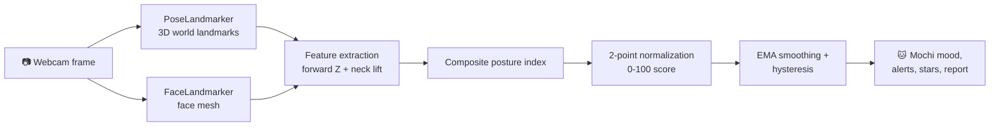

<div align="center">

# 🐱 Mochi — Your 3D AI Posture Coach

**A cozy, privacy-first posture coach that runs entirely in your browser.**
Real-time 3D pose + face tracking, a personal 2-point calibration, and a tiny cat who gets *very* upset when you slouch.


</div>

---

## ✨ What is Mochi?

Hours of laptop work quietly turn into "tech-neck". Most posture apps either nag you with a flat 2D angle (and mistake *looking at your keyboard* for slouching) or ship your webcam feed to a server.

**Mochi does neither.** It fuses **3D world-space depth** from MediaPipe Pose with **head pitch** from MediaPipe Face Landmarker, calibrates to *your* body in about 4 seconds, and gives feedback through a calico cat mascot whose mood changes with your posture, all on-device.

> 🔒 **Privacy by design:** your webcam frames are processed locally in the browser. Nothing is recorded or uploaded.

---

## 🌸 Features

| | Feature | Details |
|---|---|---|
| 🧠 | **3D posture scoring** | Fuses forward head protrusion (world Z), ear-to-shoulder lift, and face pitch into a single posture index |
| 🎯 | **2-point personal calibration** | Samples 30 frames sitting upright and 30 slouching, so the score adapts to your body, camera angle and desk |
| 🛡️ | **Hysteresis anti-flicker** | Trigger at 65 / 74 / 82% (Relaxed / Balanced / Strict) and recover 6 points higher, so alerts don't flap on the boundary |
| 🐱 | **Reactive mascot** | Mochi is happy, worried, or furious depending on your live posture, with animated expressions and effects |
| 🛍️ | **Star shop** | Earn 🌸 1 star per 15 s of good posture and unlock a beret, reading glasses and a matcha latte. Progress is saved in `localStorage` |
| 🍅 | **Pomodoro timer** | 25-minute focus / 5-minute break cycle with chimes and optional desktop notifications |
| 🧘 | **Stretch guide** | Ergonomics rules, desk stretches and a built-in 30-second stretch timer |
| 📊 | **Session report** | End-of-session summary with a Chart.js posture timeline and a downloadable JSON report |
| 🪟 | **Pop-out mini Mochi** | Floats Mochi in a Document Picture-in-Picture window so you can keep an eye on him while coding |
| 🔔 | **Smart alerts** | Web Audio chimes (no audio files needed) and rate-limited desktop notifications |
| 📱 | **Installable PWA** | Web manifest plus service worker for an app-like install |

---

## 🔬 How It Works



### The posture index

For every frame, Mochi computes three signals:

1. **Forward head protrusion**: mid-shoulder Z minus mid-ear Z in MediaPipe's 3D world coordinates
2. **Neck lift**: vertical ear-to-shoulder distance, normalized by shoulder width (so it works at any distance from the camera)
3. **Face pitch**: nose-tip offset relative to forehead–chin midpoint, giving the head tilt

These combine into a single composite index:

```
index = 1.4 × neckLift − 2.2 × forwardZ − 0.9 × facePitch
```

### Personalized scoring

During calibration Mochi records your **upright** and **slouched** averages and maps your live index between them:

```
Score (%) = 100 × (S_live − S_slouch) / (S_upright − S_slouch)
```

The score is clamped to 0–100, smoothed with an exponential moving average (`0.75 × previous + 0.25 × new`), then passed through the hysteresis gate. You only get an alert after you've been slouching longer than your chosen **patience delay** (2–15 s).

---

## 🚀 Quick Start

Mochi is a **zero-build, vanilla JavaScript** app. No bundler, no `npm install`.

```bash
# 1. Clone
git clone https://github.com/<your-username>/<your-repo>.git
cd <your-repo>

# 2. Serve locally (camera access and ES modules need http://localhost or HTTPS)
python -m http.server 8000
# or: npx serve .

# 3. Open
# http://localhost:8000
```

Then click **📷 Start Camera**, sit upright for 2 seconds, slouch once for 2 seconds, and you're live.

### Requirements

- A modern desktop browser (**Chrome or Edge recommended**, since Pop-Out uses the Document Picture-in-Picture API)
- A webcam with your **face and both shoulders visible**
- An internet connection on first load (MediaPipe models and Chart.js load from CDNs)
- A GPU-capable browser (the models use the WebGL/GPU delegate)

---

## 🕹️ Usage Tips

- **Camera placement:** put the camera at roughly eye level, centered, so both shoulders and ears are in frame.
- **Recalibrate** with 🎯 whenever you move your chair, laptop or camera.
- **Strictness slider:** start on *Balanced*; use *Strict* when you're deliberately training better posture.
- **Patience delay:** raise it if you naturally glance down at your keyboard a lot.
- **Alerts while coding:** enable 🔔 and use 🪟 Pop-Out to keep Mochi on top of your editor.

---

## 📁 Project Structure

```
.
├── index.html      # 4-page UI: Live Studio, Shop, Stretches, Benefits & 3D AI
├── style.css       # Pastel design system, laptop frame, mascot moods, responsive layout
├── app.js          # MediaPipe pipeline, calibration, scoring, gamification, reports
├── manifest.json   # PWA manifest
└── sw.js           # Service worker (app-shell caching)
```

---

## 🧰 Tech Stack

- **[MediaPipe Tasks Vision](https://developers.google.com/mediapipe)**: Pose Landmarker (lite) and Face Landmarker
- **Vanilla JavaScript (ES modules)**: no framework, no build step
- **Canvas 2D**: live skeleton overlay on the webcam feed
- **Web Audio API**: synthesized alert and reward chimes
- **Chart.js**: session posture timeline
- **Web APIs**: `getUserMedia`, Notifications, Document Picture-in-Picture, Service Workers, `localStorage`
- **Hand-built SVG** mascot with CSS-driven moods and animations

---

## 🗺️ Roadmap

- [ ] Offline support: cache MediaPipe models and CDN assets in the service worker
- [ ] Persistent multi-day posture history and weekly trends
- [ ] Break reminders driven by detected sitting time
- [ ] More mascot accessories and seasonal outfits
- [ ] Reuse one shared `AudioContext` for chimes
- [ ] Shareable posture report cards

---

## 🤝 Contributing

Ideas, bug reports and pull requests are welcome.

1. Fork the repo
2. Create a branch: `git checkout -b feature/amazing-idea`
3. Commit your changes and push
4. Open a pull request

---

## ⚠️ Disclaimer

Mochi is a wellness and ergonomics aid, **not a medical device**. It can't diagnose or treat any condition. If you have persistent neck, back or shoulder pain, please talk to a healthcare professional.

---

<div align="center">

**Built with 💖, MediaPipe, and a very judgmental cat.**
*Sit tall. Mochi is watching.* 🐱✨

</div>
